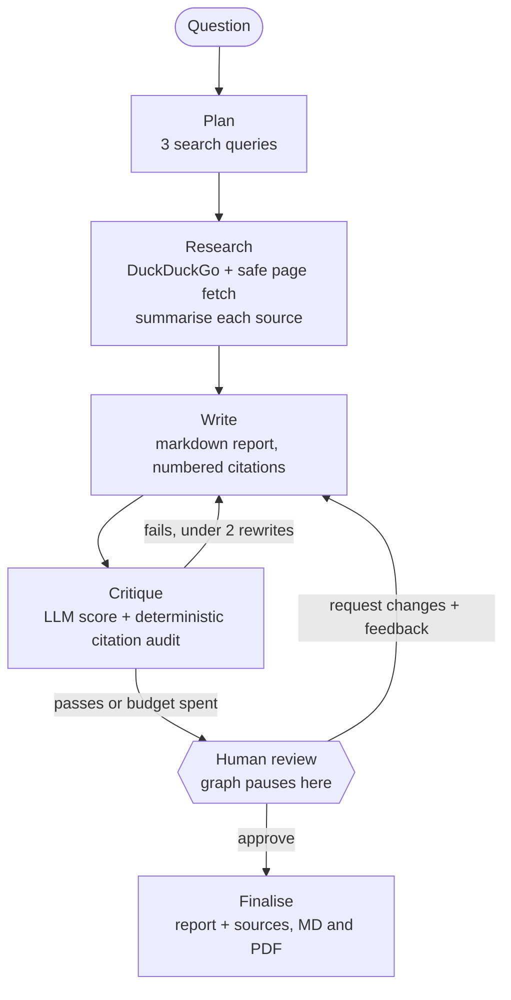

# Research Agent: plan, search, write, critique, and a human signs off

An autonomous research assistant built on **LangGraph** that turns a question into a **cited report**, reviews its own draft, and **pauses for human approval** before anything is finalised.

It is designed around the three failure modes that make research agents risky to deploy: *made-up citations*, *runaway loops*, and *untrusted web content steering the model*.

## What it does



- **Human-in-the-loop** using LangGraph `interrupt()` and a checkpointer: the graph genuinely stops, holds its state, and resumes with your decision. Nothing is published before approval.
- **Two-layer review**: an LLM critic scores the draft, and a **deterministic citation audit** independently checks that every cited `[n]` exists and every substantial paragraph has a citation. A generous critic cannot wave through an invented source (covered by a test).
- **Bounded loops**: at most 2 automatic rewrites per round and 3 human rounds, so cost and latency are predictable.
- **Free to run**: DuckDuckGo search (no key), Groq free tier for the LLM, `requests` + BeautifulSoup for pages, `fpdf2` for PDF.
- **Interfaces**: terminal runner (`run.py`) and a Streamlit UI with approve / request-changes buttons and Markdown/PDF download.

## Safety by design

| Risk | Mitigation |
|---|---|
| Poisoned search result points the agent at an internal service (SSRF) | `is_public_url` blocks non-http(s) schemes and any host resolving to private, loopback, link-local or reserved addresses (including cloud metadata `169.254.169.254`) on every request **and every redirect hop** (redirects are followed manually, max 3) before fetching |
| A web page contains "ignore previous instructions..." (prompt injection) | Page text is passed only in the user turn, wrapped as `UNTRUSTED DATA`, and the system prompt forbids following instructions inside it; verified by a test |
| Hallucinated citations | Deterministic audit rejects out-of-range `[n]` and uncited paragraphs regardless of the critic's score |
| Infinite revise loops | Hard caps on rewrites and human rounds |
| Oversized downloads | Page fetch capped at 1 MB and 10 s |

## Quick start

```bash
python -m venv venv && venv\Scripts\activate
pip install -r requirements.txt
pytest -q                                   # 16 offline tests, no key or network needed

copy .env.example .env                      # add a free GROQ_API_KEY
python run.py "What are the main trade-offs of solid-state batteries?"
streamlit run app.py                        # UI with approve / request-changes
```

Reports are written to `reports/<question>.md` and `.pdf`.

## Project structure

```
agent/graph.py     LangGraph wiring and conditional edges
agent/nodes.py     plan, research, write, critique, human_review, finalise (dependencies injected)
agent/audit.py     deterministic citation audit
agent/tools.py     DuckDuckGo search, SSRF-safe page fetcher, HTML to text
agent/export.py    markdown to PDF
run.py  app.py     terminal and Streamlit front ends
tests/             16 tests using a scripted fake LLM against the real graph
```

## Testing approach

Every external dependency (LLM, search, fetch) is injected, so the **real LangGraph graph runs in tests** with a scripted fake model. Tests cover: pause-then-resume, critique-driven rewrite, rewrite cap, human rejection feeding instructions back, human-round cap, the audit overriding a generous critic, URL de-duplication, source cap, prompt-injection framing, the SSRF guard (including a redirect to an internal host), and PDF round-trip.

One bug the tests caught during development: the JSON extractor returned the empty inner array of `{"score": 9, "issues": []}` instead of the object, silently scoring every draft 0. It now takes the outermost structure.

## What is and isn't verified

- Verified: all graph logic, safety checks and exports (tests), and the live DuckDuckGo search and page fetch.
- **Not verified here:** end-to-end report quality with a real LLM. No sample report is included on purpose, because I would not publish output I have not generated. Run it with your own free Groq key and judge the results yourself.

## Limitations and next steps

- DuckDuckGo results can be rate-limited; failures degrade to fewer sources rather than crashing.
- The SSRF guard resolves DNS before connecting, so a DNS-rebinding attacker could in theory still win the race; for production, fetch through an egress proxy that enforces the same rules.
- Summaries use only the first ~4,000 characters of a page.
- State is held in memory (`MemorySaver`); swap in `SqliteSaver` or Postgres to survive restarts.
- Next: parallel source summarisation, domain allow/deny lists, and an evaluation set scoring faithfulness of claims to sources.

## Tech

Python, LangGraph, Groq (free tier), DuckDuckGo (`ddgs`), BeautifulSoup, fpdf2, Streamlit, pytest.
